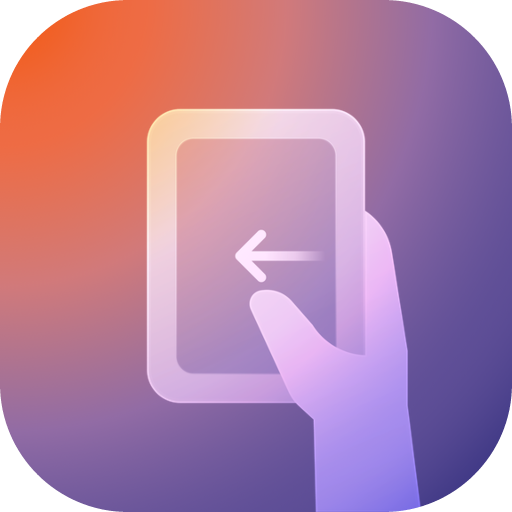
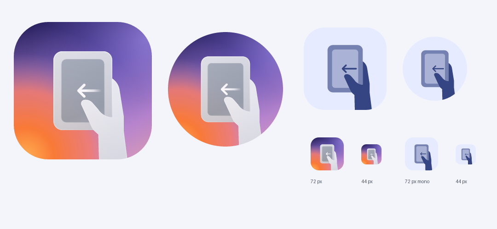

# Color Hand Operation

<p align="center"></p>

给一加和 ColorOS 做的侧边手势工具。操作方式参考三星 One Hand Operation+，设置页和工具面板则尽量跟 ColorOS 17 保持一致。

从屏幕边缘划一下，可以返回、切换应用、调音量，也可以叫出快捷工具和小组件。左右两侧、不同方向、长短滑动都能单独设置。

[下载 0.3.16](https://github.com/FallmoonXD/Color-Hand-Operation/releases/tag/v0.3.16) · [功能说明](docs/feature-status.md) · [兼容与已知问题](docs/compatibility.md) · [更新记录](CHANGELOG.md) · [开发笔记](docs/README.md)

## 能做什么

- 左右各最多 3 段触钮，分别设置直滑、上斜滑、下斜滑，以及对应的长滑动作。
- 快速工具面板：12 个自定义按钮、亮度、音量和媒体控制。
- 把常用 Android 小组件放进侧边面板，支持分页、拖动和调整大小。
- 快速启动应用、调用应用快捷方式、切换最近任务。
- 虚拟触控板、虚拟导航键、键盘组合键、屏幕放大等单手操作工具。
- 按应用停用手势，调整触发区域、角度和振动，导入或导出配置。

具体用法和还没做的部分见[功能说明](docs/feature-status.md)。

## 安装前看一下

目前还是预览版，主要在 **一加 PKR110 / ColorOS 17 / Android 17 / Root** 上测试。Android 13 及以上可以安装，但其他机型、旧版 ColorOS 和无 Root 环境还需要测试。

基础手势依靠无障碍服务；原生模糊材质和一部分系统动作需要 Root。没有相应权限或系统接口时，部分效果会退回普通材质，部分动作会不可用。

1. 到 [Releases](https://github.com/FallmoonXD/Color-Hand-Operation/releases) 下载 APK，直接安装。
2. 打开应用，在“权限与后台运行”中开启无障碍服务，并按需要设置通知、自启动和电池选项。
3. 需要原生材质和系统动作时，在 Root 管理器中授权 `dev.edgeflow`。
4. 添加小组件时，按系统提示完成绑定。

发布包沿用同一个开发签名，可以覆盖此前的同签名版本。自己编译的包如果签名不同，无法直接覆盖安装。遇到问题先看[兼容说明](docs/compatibility.md)，也欢迎带上机型、系统版本和复现步骤提 [Issue](https://github.com/FallmoonXD/Color-Hand-Operation/issues)。

## 这次更新

0.3.16 换了新的橙紫配色图标，MD3 主题图标保持原样。功能与 0.3.15 相同，也整理了首页、说明文档和开发笔记。

<p align="center"></p>

## 自己编译

使用 **JDK 21** 和仓库里的 Gradle wrapper。当前构建环境为 Gradle 9.5.1、AGP 9.2.1、Android SDK platform 35 / build-tools 36.0.0。

配置 `ANDROID_HOME`，或在本地 `local.properties` 中设置 `sdk.dir`，然后执行：

```powershell
# Windows
./gradlew.bat assembleDebug
```

Linux / macOS 使用 `./gradlew assembleDebug`。APK 在 `app/build/outputs/apk/debug/app-debug.apk`；依赖已缓存时可加 `--offline`。

普通构建不需要 Python、Clip Studio 或原始参考 APK。包名仍为 `dev.edgeflow`，`replica/` 是项目内的 UI 模块，不会加载其他应用的代码。设备调试、图标导出和测试入口见[开发笔记](docs/README.md)。

## 项目与素材

这是个人项目，与三星、OPPO、一加官方无关。交互参考 OHO+，图标原始轮廓和部分系统资源保留了来源记录，见 [THIRD_PARTY_NOTICES.md](THIRD_PARTY_NOTICES.md)。项目暂未选定统一的开源许可证，第三方素材的权利归原作者所有。
