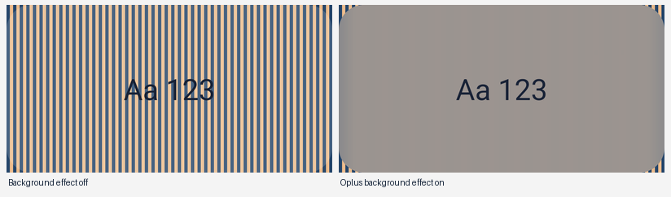

# CHO 的 ColorOS 17 渲染方案

本文记录改版前的绘制路径和对应实机结果。当前试用版的页面结构、控件与材质取舍见[逐页、逐组件 COUI 选型](coui-ui-audit.md#试用进度)。

设置页用 ColorOS Settings 的主题、排版和控件状态。控件确实盖住滚动内容时，可以给它的背景加 Oplus View 效果。快速工具、音量和小组件覆盖在别的应用上，继续由各自的窗口负责取景和合成。手势波形、角度编辑器等跟随输入的图形用 Canvas。

设置页的背景材质集中在 `SettingsSurface`。工具栏和页内动作列表在自己的 View 下取景。菜单、调色板和确认框则从各自的窗口取景。已有的快速工具、音量和小组件继续使用各自的跨应用捕获窗口。

首页标题的 `Color` 来自 ColorOS 17 官网首屏的品牌字标。首屏视频和海报里有相同的五个字母。按 4320 × 3414 海报中的轮廓和间距制作了一个矢量，保留圆形 `o` 和短弯钩 `r`。系统开启粗体时在同一轮廓上加细描边。`Hand Operation` 跟随系统字体，整句共用基线，读屏朗读完整名称。[ColorOS 17 官网](https://www.coloros.com/version/coloros17/) · [首屏原图](https://coloros-website-cn.allawnfs.com/website-resource-20260917/os17/images/module1/pc/imgLog.png)

## 同窗口材质的实机结果

在 PKR110、ColorOS 17、Oplus SDK 40.23 上，用一个普通应用 UID 绘制交替条纹、圆角卡片和文字。测试应用没有申请权限，调用 `OplusViewBackgroundRenderEffect.setBackgroundRenderEffect()` 也没有使用 Root 或隐藏 API 豁免。给卡片背景加 12 dp 模糊后，条纹变平，前景文字仍清晰。

三次运行使用相同的 1088×560 px 卡片和取样区域。灰度标准差依次为 **56.50 → 0.46 → 56.50**，对应关闭、开启、再次关闭。12 dp 是这个实验的参数，产品参数应取对应原生控件的样式。此结果覆盖当前固件、硬件加速、同一窗口内的背景模糊。PopupWindow、其他固件、描边与焦散需要各自验证。

## 先确定谁绘制背景

| 场景 | 渲染方式 | CHO 的接入位置和回退 |
| --- | --- | --- |
| 页面底色、卡片、行、文字、分隔线 | 解析 Settings Theme 属性，用普通 View、Drawable、Ripple 绘制 | `ColorOsTheme`、`ColorSettingsScaffold` 和 `MainActivity.row()`。使用 `couiColorBackgroundWithCard`、`couiColorSurface`、`couiColorLabelPrimary/Secondary` 和当前强调色。资源不可用时使用现有亮暗色板 |
| 同窗口中悬在内容上的小控件 | 目标 View 的背景使用 Oplus RenderEffect，图标单独绘制 | 返回和更多按钮使用 Settings 工具栏的 20 px 模糊与两层混色。滚动内容经过圆形按钮，标题区域铺页面底色。能力不可用时使用主题色圆角背景 |
| 设置页内嵌选择层 | 自己的面板背景、scrim、滚动区、内容和底部操作区 | `ColorActionSheet.showEmbedded()` 只给面板背景加模糊及主题色，字、选中态和配置齿轮正常绘制。返回与无障碍焦点仍由宿主页管理 |
| 独立 Dialog / PopupWindow | 在卡片自己的 ViewRoot 上创建背景 Drawable，按窗口模糊开关切换 | 菜单使用 ColorOS 的 160 px 半径和 popup 混色，确认框用 200 px，底部弹窗用 400 px。调色板只给卡片取景。能力缺失、系统关闭模糊或进入省电时使用不透明主题底色 |
| 跨应用实时浮层 | 一个面板背景拥有捕获请求，接收 HardwareBuffer 后由 AGSL 混色、描边和光学层合成 | `ColorOsSurface` 的面板样式、`NativeMaterial`、`NativeBlur`。沿用已确认的捕获与 shader 参数。按现有策略处理服务缺失、Root 被拒、首帧超时、软件 Canvas 和脱离窗口 |
| 图形、光标、编辑反馈 | Canvas/矢量直接绘制，手势或动画期间刷新 | `GestureWaveView`、`AngleEditorView`、`ColorPalettePicker` 和光标。只给需要手势输入的窗口接触摸，辅助图形使用不可触摸窗口 |
| 外部内容 | 内容生产方或 Android 系统绘制 | 应用图标、任务快照、AppWidget、IME、SAF、系统授权、录屏和侧边栏由相应提供方绘制。CHO 管容器、裁切、焦点和生命周期 |

`PanelStyle.window()` 目前给主浮层挂 `ColorOsSurface(..., 2)`。`GlassDialogBuilder` 的独立表单窗口走样式 3。按钮和媒体子层通常用样式 0，只消费本窗口的材质和光学绘制。只有样式 2/3 建立 `NativeMaterial`。新增控件时应先确认其宿主，避免每个按钮各自启动捕获。

## 设置页逐页安排

以下路由对应 `MainActivity.render()`。每行同时给出内容的归属，便于改某一页时找到实际代码。

| 路由 / 页面 | 内容应怎样画 | 合适的改动与验证 |
| --- | --- | --- |
| `home` 首页 | 主题页底、分组卡片、总开关、触钮状态行。品牌标题和更多按钮固定在工具栏中 | `ColorSettingsScaffold` 使用与二级页相同的标题样式和按钮尺寸。检查窄窗口、大字号以及滚动时的渐变 |
| `left` / `right` / `extra_left` / `extra_right` / `extra2_left` / `extra2_right` | 同一页模板。方向图标用矢量，摘要用 TextView，开关与尺寸/位置用现有 COUI 风格控件 | 触钮调节期间仅更新草稿显示和边缘预览。确认、取消、切后台、双侧对齐和第三对触钮都要覆盖 |
| `advanced` / `gestures` | 分组、文本、开关与滑条。振动方式和长滑时间采用普通设置行 | 沿用 `ColorSwitch` / `ColorSlider`，保存后更新相关行。检查手指从滑条改为纵向滚动、取消拖动和系统动画关闭 |
| `angle` | 卡片内由 `AngleEditorView` 画扇区、方向箭头和拖柄，标签按系统字体缩放 | 只更新被拖动边界。镜像、最小夹角、多指取消及 RTL 下分别检查几何与语义节点 |
| `exceptions` / `action_app` | 应用列表用原应用图标、标题、摘要及复选/单选控件。搜索和加载状态使用同一页底 | 保留异步读取、generation 检查、未绑定位图释放。跨主题重建后核对选中状态和滚动位置 |
| `action_shortcut` | 应用分组、箭头、真实快捷方式图标和可用状态。内容使用共享设置滚动区 | `ShortcutPicker.embedded()`。测试展开/收起、无条目、应用卸载、返回和保留的原选择层 |
| `tools` | 设置页内只放编辑和预览入口 | 编辑进入 `ToolsSettingsActivity` 的不透明设置页。预览打开独立快速工具浮层，两者按不同宿主绘制 |
| `widgets` | 循环翻页开关和预览入口使用设置行 | 服务开启时由 `WidgetOverlay` 托管 `WidgetPanel`。服务关闭时，设置页的预览入口使用 `WidgetActivity`。返回时核对原节点、滚动位置和选中态 |
| `launcher` / `launcher_columns` | 最近应用开关、编辑入口、列数单选 | 设置选择用 `ColorRadioButton`。快速启动预览使用独立浮层，进入编辑态后显示添加和选项 |
| `tasks` | 最近任务数量使用单选行，兼容已有数量设置 | 实际任务内容留给 `TaskSwitcherOverlay`。设置页只读当前数量，预览关闭后核对选择 |
| `touchpad` | 指针速度滑条和预览入口使用设置控件 | 虚拟触控板的触摸面和光标单独绘制。滑条取消、预览返回和速度读回分别检查 |
| `navigation` / `navigation_action` | 排列开关、大小滑条、导航项、齿轮锚定菜单和二级动作列表 | `ColorPopupMenu` 管短菜单，二级页用设置单选行。编辑、重排和返回时保留父页 |
| `keyboard` | 说明和预览入口用设置卡片 | 真正的快捷键编辑是浮层表单。EditText 使用原生输入、选区与错误提示；超长名称应保留输入焦点 |
| `permissions` / `backup` | 权限状态、导入导出入口、普通提示使用语义色和标准行 | 跳至系统设置、Root 管理器或 SAF 后由系统管理界面。回到 CHO 时重新读取状态 |
| `widget_migration` / `about` | 状态、计数、版本和应用信息用普通设置排版 | 迁移报告突出失败原因及需要配置的组件。关于页读取安装版本和应用图标 |

`ToolsSettingsActivity` 的 3×4 编辑格、可用工具和应用选择子页使用设置卡片、搜索栏、真实图标、选中态和拖动反馈。编辑页的加减图标来自系统资源；拖动阴影属于当前窗口。离开未保存草稿时使用 `ColorDialogBuilder` 确认框。

## 菜单、选择层和表单

| 入口 | 当前宿主与建议 | 交互验收 |
| --- | --- | --- |
| 首页更多、减少触钮、导航项齿轮 | `ColorPopupMenu` 创建锚定 PopupWindow。卡片使用当前窗口的背景 Drawable、圆角、阴影和行 Ripple | 锚点附近可用空间、RTL、键盘遮挡、点外部关闭、危险项色和分隔线 |
| 选择手势动作 | 内嵌 `ColorActionSheet`。动作行和配置齿轮分别有点击与无障碍语义，保留自有布局 | 从配置页返回同一选择层、同一滚动位置。返回按钮与名为“返回”的动作行分别检查 |
| 触钮颜色 | `ColorPaletteSheet` 以 Dialog 形式打开 `ColorActionSheet`，色环、SV 方块、网格、透明度和色样由 Canvas 绘制 | 网格/色环、HEX 输入、IME、确定和取消。棋盘格只出现在透明度展示中；旧浮点透明度按百分比显示 |
| 恢复默认、未保存退出、删除组件/页面 | 设置页用 `ColorDialogBuilder`；浮层内按上下文使用 `GlassDialogBuilder` | 消息简短时居中，长列表/表单使用底部选择。按钮随字宽换行，危险项可读，取消不提交 |
| 快速启动添加、文件夹菜单与编辑、键盘组合键 | 短菜单跟随实际按钮。长列表和输入使用独立表单窗口，按需获得 IME 焦点 | 子窗口关闭后父层可操作，退出动画期间不穿透点击。失去有效窗口 token 时取消展示 |
| 小组件页面、卡片、移动、provider 选择 | `WidgetPanel` 管理菜单、搜索和选择列表。系统绑定或提供方配置需要打开 Activity 时，由 `WidgetActivity` 接收结果 | 新增时取消应释放新 ID。重新配置已有组件时取消应保留原 ID。返回先关闭最上层菜单，再关面板 |

ColorOS 的 `COUIPopupListWindow.setUseBackgroundBlur()` 把开关传给内外菜单容器。`RoundFrameLayout` 转交 `COUIBackgroundBlurBuilder`，由 ViewRoot 管理背景 Drawable、混色、圆角和半径。`COUIBottomSheetDialog.applyBlurParams()` 也有自己的明暗混色与半径选项。试验 Popup 或 Dialog 时，应使用它自己的窗口做截图比较。同窗口 View 实验的通过结果只能用于同窗口控件。

## 手势和跨应用浮层

| 表面 | 推荐渲染与当前实现 | 必查行为 |
| --- | --- | --- |
| 左右触钮、设置中的触控区域预览 | `EdgeHandleView` 和临时预览使用窄无障碍窗口，颜色和透明度直接绘制。预览不可点 | 系统栏安全区、屏幕方向、预览撤销、左右段优先级、主开关和应用例外 |
| OHO+ 手势波形 | 两个固定窄绘制窗口，`GestureWaveView` 用 Canvas 画曲线与方向箭头。箭头在当前触点上方三个图标高度，靠近上下边缘时限位 | 左右侧、六个方向、长短滑、取消、屏幕边缘和回弹。面板锚点仍取真实触点 |
| 快速工具与 `ToolsActivity` | `ToolsBackdrop` / `ColorOsSurface` 承担主窗口背景，按钮、媒体胶囊和 `GlassSeekBar` 绘制在其上。激活态使用主题强调色 | 左右触发位置、亮度/音量/媒体可读性、首帧、连续打开关闭、子菜单与视频焦点 |
| 音量浮层 | `VolumeOverlay` 在窗口或附着 View 上挂现有样式 2，图标和音量轨道保持前景清晰 | 音量变化、长按、超时退出、模糊/轮廓分别关闭后的文字对比度 |
| 小组件面板 | `WidgetOverlay` 使用可接收返回的无障碍窗口。外壳由 `PanelStyle.window()` 处理，组件内容交给 `SizedWidgetHostView` / RemoteViews，移动和缩放把手用 Canvas | host ID `17672`、分页、尺寸上报、点击 provider、编辑取消。与快速工具一样，普通打开时底下的 Activity 应保持 resumed |
| 快速启动 | 主 Dialog 使用样式 2。应用和文件夹图标采用真实图标、合成缩略图、普通文字及 Ripple | 页数、图标异步加载、编辑态与浏览态、悬停抬手选择以及子菜单关闭 |
| 任务切换 | 外壳用主窗口材质。已有系统任务快照作为图片内容，读不到快照时显示应用图标 | 任务消失、受保护内容、刷新/关闭时释放位图、焦点和取消旧查询 |
| 虚拟触控板、导航键面板 | 外壳采用共享窗口材质。触控面、指针、按键与状态采用 Canvas、系统矢量和按钮 Drawable | 光标窗口不可触摸，注入时面板临时让出输入，手势完成/取消后恢复。导航键横竖排列和命中区独立验证 |
| 键盘快捷方式、服务内应用/快捷方式选择器 | 菜单外壳取浮层样式，文字、列表、齿轮和输入使用 `GlassDialogBuilder` / `ColorPopupMenu`。非输入面板保持前台应用焦点 | 输入框打开键盘，编辑取消、名称错误提示和延迟发送按键时的前台变化 |
| 系统屏幕放大、屏幕放大镜 | Android MagnificationController 负责放大内容；仅放大镜的控制区使用 CHO 的窗口材质，倍率和按钮直接绘制 | API 33 以 scale 判断，34+ 使用激活状态。打开、平移、调整倍率、关闭和恢复之前的状态 |
| 屏幕自由移动 | `ScreenMoveOverlay` 单独管理截图/HardwareBuffer、内容位移及输入映射；局部控制区挂现有材质 | 截图失败、受保护画面、边界命中、画面关闭后释放 buffer，控制区不吞掉映射点击 |
| 桌面与通知图标 | Android AdaptiveIconDrawable 负责裁切和 MD3 着色，通知使用专用单色矢量 | 彩色、MD3 和通知分开校验，在小尺寸、圆形及圆角遮罩下检查 |

## 实现与验证

1. **先核对主题与基本控件。** 对照原生显示/声音页和 CHO 首页的运行时主题属性。开关轨道在这台 560 dpi 设备上为 154×84 px，圆径 63 px，内边距 10.5 px，对应 44×24、18、3 dp。已有 `ColorSwitch`、`ColorSlider`、`ColorRadioButton`、`ColorCheckBox` 负责状态和无障碍语义。滑条拇指的渐变、缓存阴影和按压覆盖层参考 `TexturedThumbRenderer`。字体使用系统 Typeface 及当前字重调整，字号使用 sp。
2. **工具栏。** 首页更多和二级页返回共用同窗口材质。背景模糊与轮廓有各自的系统开关。`ToolbarEdge` 通过 OplusMaterialUtil 设置 COUI 圆形按钮的亮边与阴影，在 PKR110 上单独关闭再开启轮廓，按钮裁图恢复到相同像素。按压沿用 Ripple。每个进程探测接口签名，挂载和主题变化时更新，脱离窗口时清除。
3. **菜单与选择层。** 页内选择列表用同窗口效果，首页菜单和调色板使用各自的窗口。在 PKR110 上，普通确认框仅设置 Android 的窗口模糊半径时仍能看见底下的文字。改成与 COUI 相同的 `ViewRootManager` 卡片背景后，正文和下层应用可以清楚区分。接口缺失时使用 `ColorOsTheme.popup()`。
4. **跨应用面板按现有参数做回归。** 快速工具、音量、小组件以已确认效果为基准。其他服务面板共用相同的捕获生命周期和各自前景色。新的列表行和按钮使用父窗口的结果或局部绘制，先记录活动客户端、帧数及释放，再决定是否需要新的捕获表面。

## 验证矩阵

| 条件 | 检查方法与合格表现 |
| --- | --- |
| 渲染方式是否正确 | 网格/条纹对照图跑关闭、开启、再次关闭。比较背景采样区，另外检查前景文字和边缘。独立窗口重复实验，记录实际窗口类型 |
| 主题与可读性 | 亮/暗、系统强调色、主题商店 skin、字体放大、RTL。正文、次要文字、禁用态和危险操作在同一底色上可辨 |
| 模糊与轮廓开关 | 分别切换两项设置，再测省电、无 Root、服务不存在、拒绝与超时。回退能显示内容，恢复时只重新建立必要的请求 |
| 生命周期 | 首帧、快速重复打开、旋转、切后台、息屏、无障碍断开/重连。宿主退出后客户端归零，旧 buffer 回调不能覆盖新窗口 |
| 输入与无障碍 | 列表滚动和滑条竞争、多指/CANCEL、预测返回、IME、TalkBack action。原生 checked/range/label、点击区域和焦点顺序正确 |
| 性能与内存 | 同机同场景记录 `dumpsys gfxinfo` 的帧耗时、活动捕获数、首帧等待和重复开关后的内存趋势。按测试时刷新率比较，静止页面不持续刷新 |
| 系统/第三方内容 | 实际 AppWidget、系统 SAF、权限页、受保护任务预览和系统录屏。检查回到 CHO 后的状态和窗口，分别记录外部提供方的限制 |

PKR110 实机检查覆盖首页大标题与收起标题、独立菜单、页内动作列表、调色板键盘、确认框，以及关闭系统模糊后的实色回退。1.45 倍字号和阿拉伯语布局下，首页仍只有一个完整标题，更多按钮会镜像到左侧。快速工具、音量、小组件各占一个捕获请求，小组件打开二级菜单时仍为一个，全部关闭后为零。主题商店自定义皮肤、其他机型及无 Root 环境还有待实测。

## 查资料的位置

本地语料以 `analysis/coloros17-native-ui-20261106/` 为根。`sources/com.android.settings/sources/com/coui/appcompat/` 下重点查看 `COUIMaterialEffect`、`COUIMaterialBlurEffect`、`COUIMaterialStateManager`、`toolbar/ToolbarMaterialEffectDelegate`、`uiutil/COUIBackgroundBlurBuilder`、`poplist/COUIPopupListWindow`、`panel/COUIBottomSheetDialog`、`seekbar/renderer/TexturedThumbRenderer` 和 `animation/dynamicanimation/COUISpringForce`。相册色板对应 `de_toolkit_color_picker_portrait.xml`、`DeToolkitHsvPicker`、`DeToolkitRGBPicker`。SystemUI 材质可从 `blurability`、QS tile drawable、strokeshader 和 optics adapter 查起。原始文件来源、哈希和检索方式见[原生 UI 调查](coloros17-native-ui-research.md)。

工程中已有的行为记录见[设置控件](coloros-controls.md)、[面板生命周期](material-policy.md)、[相册调色板](gallery-color-palette.md)、[页面与菜单清单](coloros-menu-audit.md)和[页面返回](continuous-pages-validation.md)。
